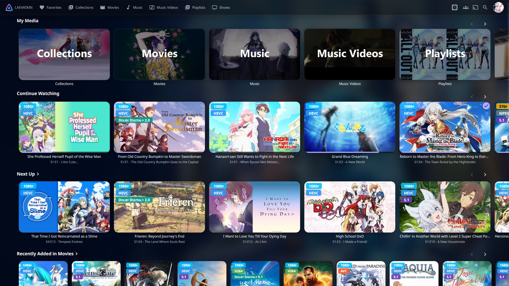
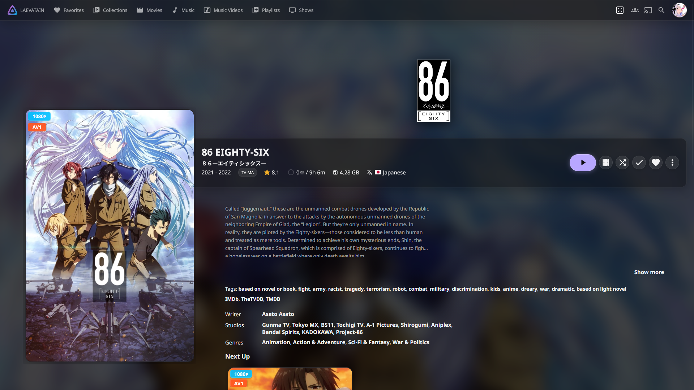
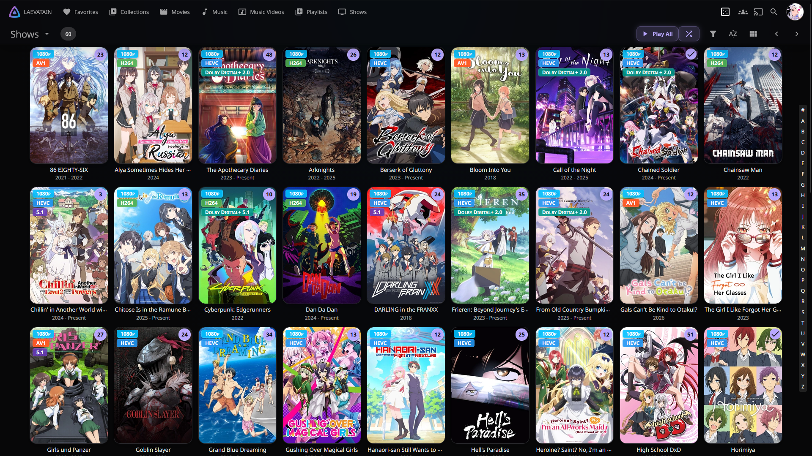
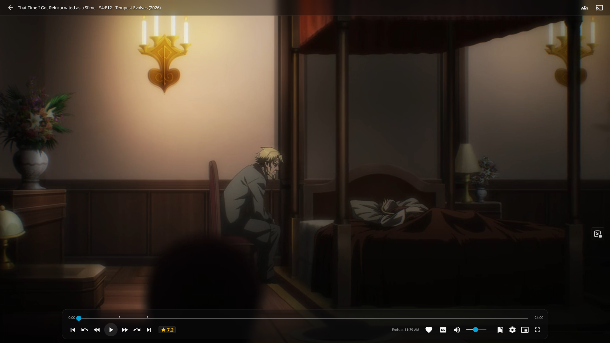

# Jellyfin Themes

A small collection of custom CSS themes for Jellyfin Web. Each theme is kept in its own folder so it can be developed, previewed, and released independently without mixing source files across designs.

## Included Themes

| Theme | Folder | Jellyfin Target | Status |
| :--- | :--- | :--- | :--- |
| Jellyfin Obsidian Material | [themes/jellyfin-obsidian-material](themes/jellyfin-obsidian-material) | Jellyfin 12.1.x | Active |

## Project Rules

The goal of this project is to provide a visual refresh without materially altering Jellyfin's functionality or layout structure.

- Preserve Jellyfin's existing information architecture and navigation patterns.
- Prefer visual polish over structural rewrites: color, spacing, contrast, glass surfaces, and refinement.
- Keep interactions familiar and readable; avoid major layout churn or aggressive UI redesigns.
- Use CSS to refine the experience rather than replace core Jellyfin components.
- Favor maintainable, layered styling over one-off hacks.

## AI Usage

This repository was developed with AI assistance, primarily for documentation drafting, repo cleanup, and summarizing design/testing notes. Human review remains the final authority for theme decisions, compatibility, and release quality.

## Repository Structure

```text
jellyfin-themes/
├── README.md
├── .gitignore
├── images/
│   ├── main.png
│   ├── details.png
│   ├── medialist.png
│   └── playerosd.png
├── scripts/
│   ├── start.py
│   ├── serve-css.sh
│   └── serve-css.vbs
├── themes/
│   └── jellyfin-obsidian-material/
│       ├── README.md
│       ├── theme.css
│       ├── 01-tokens.css
│       ├── 02-shell.css
│       ├── ...
│       ├── 10-tweaks.css
│       └── bundle.min.css
└── LICENSE
```

## Gallery

<table>
  <tr>
    <td align="center">
      
      <br><strong>Main layout</strong>
    </td>
    <td align="center">
      
      <br><strong>Details view</strong>
    </td>
  </tr>
  <tr>
    <td align="center">
      
      <br><strong>Media list</strong>
    </td>
    <td align="center">
      
      <br><strong>Player OSD</strong>
    </td>
  </tr>
</table>

## How to Use a Theme

1. Open the theme folder you want to use.
2. Review the theme README and compatibility notes.
3. Copy the bundled CSS from `bundle.min.css` into Jellyfin's Custom CSS field.
4. Or preview the files locally in a browser before applying them.

## Local Preview

You can serve the current theme without editing any script paths. The preview script auto-detects the correct theme folder from the repository layout:

```bash
cd jellyfin-themes
python3 scripts/start.py
```

Or, if you are already inside a theme folder:

```bash
cd themes/jellyfin-obsidian-material
python3 ../../scripts/start.py
```

Then open:

```text
http://localhost:8787/
```

The helper scripts in the `scripts/` folder are also available for quick local preview workflows on Windows or Linux, and they pass through to the same auto-detection logic.

## Theme Maintenance

- Keep each theme self-contained in its own folder.
- Use a consistent naming pattern for CSS layers and output files.
- Update the theme README when compatibility or structure changes.
- Bundle the final release into `bundle.min.css` before shipping or publishing.
